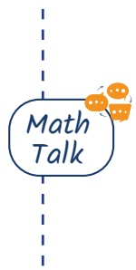

？ **Example 10:** A TV is bought at a price of ₹21,000. After 1 year, the value of the TV depreciates by 5%. Find the value of the TV after one year.

The amount of reduction in the value is 5% of $\begin{array} { r } { 2 1 \mathrm { , } 0 0 0 = 0 . 0 5 \times 2 1 \mathrm { , } 0 0 0 } \\ { = 1 0 5 0 . } \end{array}$

The current value is 21,000 – 1050 = 19,950.

The value of the TV after 1 year will be 95% of the current value = 95% of 21,000 = 0.95 × 21,000 = 19,950.

The value of the TV after 1 year will be ₹19,950.

? **Example 11:** The population of a village was observed to be reducing by about 10% every decade. If the current population is 1250, what is the expected population after 3 decades?

The population 1 decade later will be 0.9 times the population of the current decade.

Therefore, the population after 1 decade will be 1250 × 0.9.

The population after 2 decades will be 1250 × 0.9 × 0.9.

The population after 3 decades will be $\begin{array} { c } { { 1 \bar { 2 } 5 \bar { 0 } \times 0 . 9 \times 0 . 9 \times 0 . 9 } } \\ { { = 9 1 1 . 2 5 . } } \end{array}$

First decade’s decrease = 0.1 × 1250 = 125.

$$
\mathrm { P o p u l a t i o n ~ a f t e r ~ 1 ~ d e c a d e } = 1 2 5 0 - 1 2 5 = 1 1 2 5 .
$$

Second decade’s decrease

$$
\mathrm { P o p u l a t i o n ~ a f t e r ~ 2 ~ d \acute { e } c a d e s } \atop = 1 1 2 5 - 1 1 2 = 1 0 1 3
$$

Third decade’s population decrease = 0.1 × 1013 = 101.3 ≅ 101.

Population after 3 decades = 1013 – 101 = 912.

Rounding off, we can say that the expected population after 3 decades will be around 910.

## Tricky Percentages

## Would You Rather?

？ You have won a contest. The organisers offer you two options to choose from:

Option A: You deposit ₹100 and you get back ₹300.

Option B: You deposit ₹1000 and you get back ₹1500.

What is the percentage gain each option gives? You can choose any option only once. Which option would you choose? Why?

