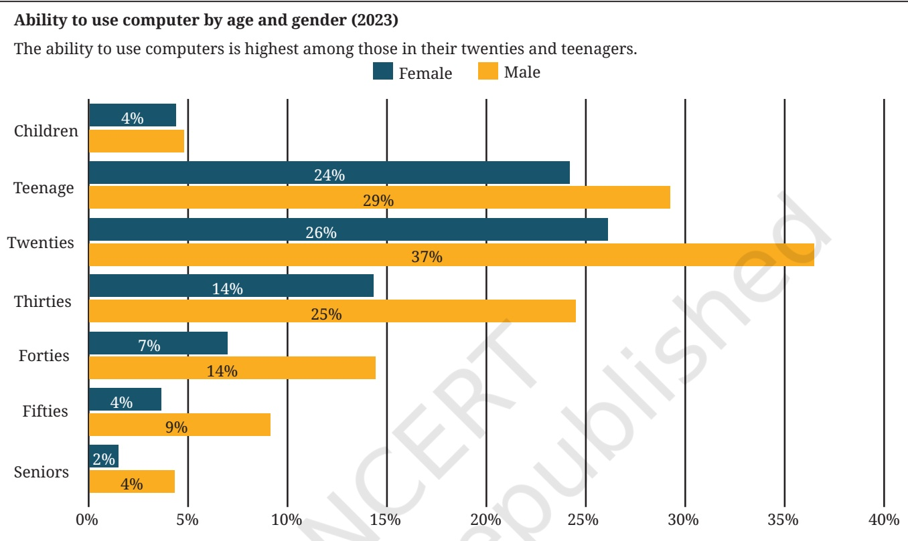

14. In a room of 100 people, 99% are left-handed. How many left-handed people have to leave the room to bring that percentage down to 98%?

15. Look at the following graph.

Source: NSS Round 79, Comprehensive Annual Modular Survey, National Statistics Office

## Data For India

Based on the graph, which of the following statement(s) are valid?

(i) People in their twenties are the most computer-literate among all age groups.

(ii) Women lag behind in the ability to use computers across age groups.

(iii) There are more people in their twenties than teenagers.

(iv) More than a quarter of people in their thirties can use computers.

(v) Less than 1 in 10 aged 60 and above can use computers.

(vi) Half of the people in their twenties can use computers.