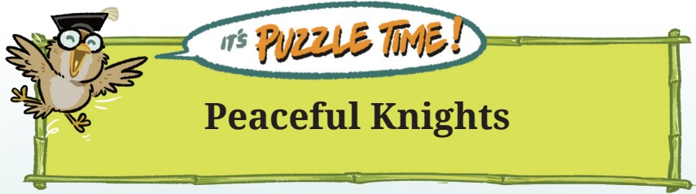
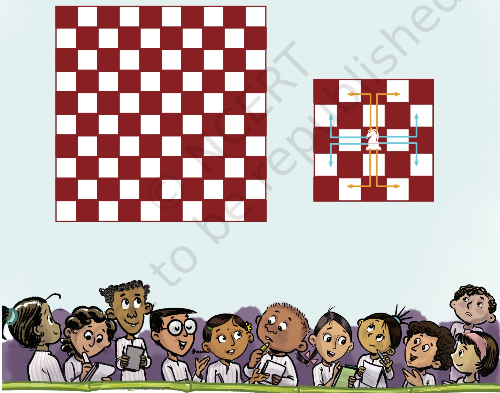

## IT's PUZZLE TIME!

Place 8 knights on the chess board so that no knight attacks another. A knight moves in an ‘L-shape’. It can move either (a) two steps vertically and one step horizontally, or (b) two steps horizontally and one step vertically. Possible moves of a knight are shown below.

