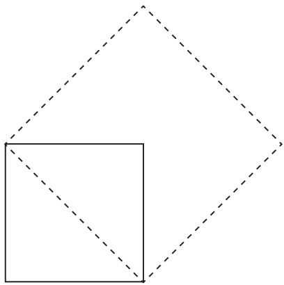
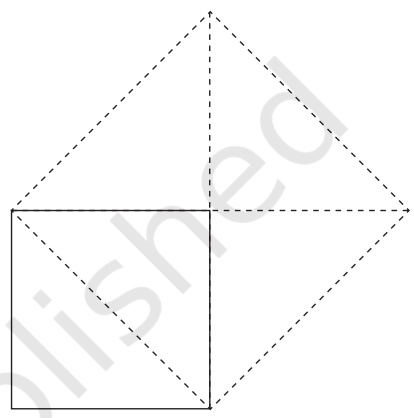
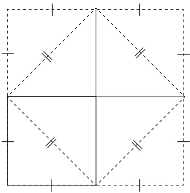

Why does the new dotted square have double the area of the original square?

In many of the constructions in the Śulba-Sūtra, it is desirable to construct, where needed, what Baudhāyana calls ‘east-west’ and ‘north-south’ lines, i.e., horizontal and vertical lines that are perpendicular to each other. Can you draw some horizontal and vertical lines to see why the new square has double the area of the original square? You could draw some horizontal and vertical lines as shown on the right.

？ Why should the extension of the vertical and horizontal sides of the original square pass through the vertices of the dotted square?

[**Hint:** From the diagonal property of a square, the line that bisects an angle passes through the opposite vertex. Argue why the vertical and horizontal sides of the original square bisect the two angles of the dotted square.]

So, the new square has double the area of the original square, because the original square is made up of two small triangles, while the new square is made up of four small triangles.

？ Moreover, all these small triangles are congruent to each other. Can you explain why?

Adding some more horizontal and vertical lines can make the situation even clearer:

