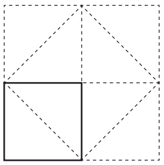
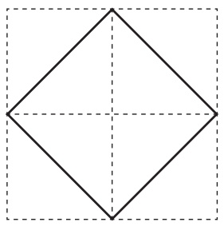
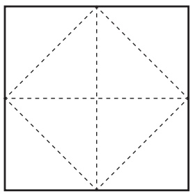
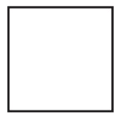
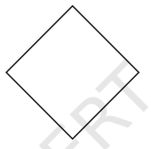
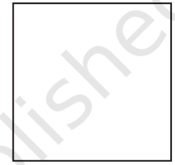
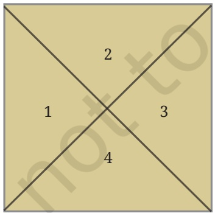
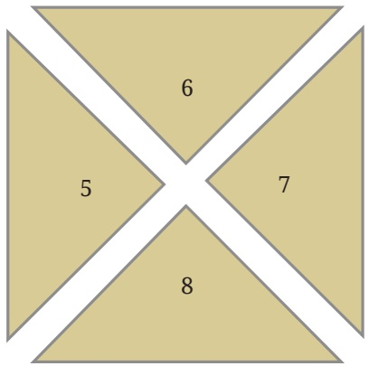

So we can make the following sequence of squares:

Each square has double the area of the previous one, as they are made up of 2, 4, and 8 small triangles, respectively.

**Doubling a Square Using Paper**

？ Cut out two identical squares of paper. Draw, label, and cut as follows:

Square 1

Identical Square 2

Now place the pieces 5, 6, 7, and 8 around Square 1 to get a square with double the area.