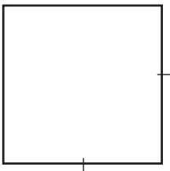
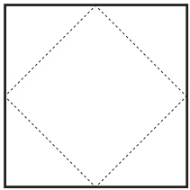
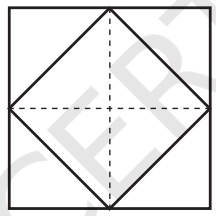
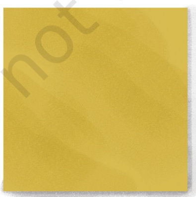
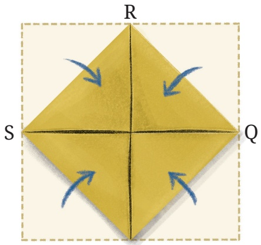

## 2.2 Halving a Square

？ Now suppose we are given a square, and we want to construct a square whose area is half that of the original square. How would you do it?

One way to do it is to reverse the construction of the previous section. We draw a tilted smaller square inside the larger one:

Why is the smaller inside square half the area of the larger square? Again, adding some east-west and north-south lines can explain it:

## Halving a Square Using Paper

？ Cut out a square from a piece of paper. Now make a square whose area is half the area of the first square.

？ Will the square having half the sidelength have half the area? Why not? How many such squares will fill the original square?

Fold the square paper inward, as shown, such that the crease lines pass through the midpoints of the sides. PQRS is the required square with half the area.

P