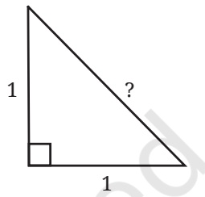
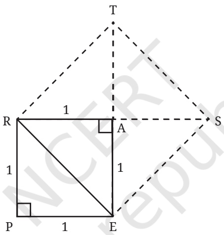
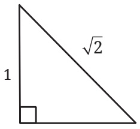
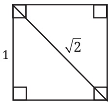

Why is PQRS a square? Why is its area half that of the original paper?

Explain by connecting QS and PR, finding the different angles formed, and then using tringle congruence.

## 2.3 Hypotenuse of an Isosceles Right Triangle

Recall that in a right triangle, the side opposite to the right angle is called the **hypotenuse.**

？ Find the hypotenuse of this isosceles right triangle.

We know that a square of side 1 unit is made of two such isosceles right triangles. We also know that the square constructed on the diagonal of this square has twice the area of the original square.

We do not yet know the length of the hypotenuse, but we know the area of the square REST on it!

Area of REST = 2 × Area of PEAR

= 2 × 1 = 2 sq. units.

We know the relation between the side and the area of a square. If c is the hypotenuse ER, then

$$
\mathrm{Area}   of  \mathrm{REST} = c \times c = c^{2}.
$$

$$
\scriptstyle { \mathrm { S } } 0 ,   c ^ { 2 } \; = \; 2 .
$$

Therefore, $c = { \sqrt { 2 } } .$

Thus, the hypotenuse is of length $\sqrt { 2 }$ units.

1

1