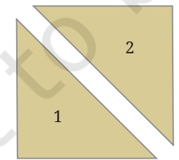
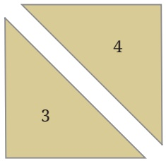

So a terminating decimal cannot have 2 or 2.000... as its square.

Thus, the decimal expansion of $\sqrt { 2 }$ must go on forever, i.e., it has a non-terminating decimal representation.

？ Can $\sqrt { 2 }$ be expressed as a fraction $\frac { m } { n }$ , where m and n are counting numbers?

If $\sqrt { 2 }$ could be expressed as $\frac { m } { n }$ , then we would have

$$
{ \sqrt { 2 } } = { \frac { m } { n } }
$$

$$
2 = { \frac { \; m ^ { 2 } \; } { n ^ { 2 } } }
$$

$$
2 n ^ { 2 } = m ^ { 2 } .
$$

Recall that in the prime factorization of a square number, each prime occurs an even number of times. So in the equation $2 n ^ { 2 } = m ^ { 2 }$ , the prime 2 would occur an odd number of times on the left side and an even number of times on the right side. This is impossible. Thus $\sqrt { 2 }$ cannot be expressed as a fraction $\frac { m } { n }$

This beautiful proof that $\sqrt { 2 }$ cannot be expressed as $\frac { m } { n }$ where m, n are counting numbers was given by Euclid in his book Elements (c. 300 BCE). We will discuss it in more detail in a later class.

Thus the number $\sqrt { 2 }$ cannot be expressed as a terminating decimal or a fraction. But we can think of it as a certain non-terminating decimal: $\sqrt{2}=1.41421356.$ …

## Figure it Out

1. Earlier, we saw a method to create a square with double the area of a given square paper. There is another method to do this in which two identical square papers are cut in the following way.

Can you arrange these pieces to create a square with double the area of either square?

2. The length of the two equal sides of an isosceles right triangle is given. Find the length of the hypotenuse. Find bounds on the length of the hypotenuse such that they have at least one digit after the decimal point.

(i) 3 (ii) 4 (iii) 6 (iv) 8 (v) 9