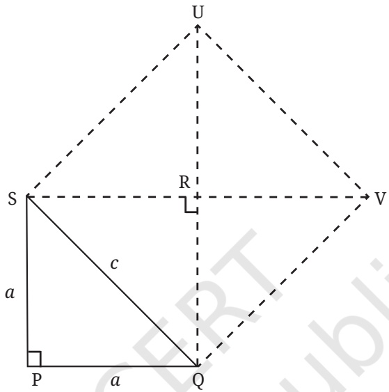

3. The hypotenuse of an isosceles right triangle is 10. What are its other two sidelengths? [**Hint:** Find the area of the square composed of two such right triangles.]

## General Solution

The relation between the areas of a square and the square on its diagonal can be used to find a general relation between the hypotenuse and the other two sides of an isosceles right triangle.

Let a be the length of the equal sides and c the length of the hypotenuse.

Area of SQVU = 2 × Area of PQRS

$$
S 0 , c ^ { 2 } = 2 \bar { a } ^ { 2 }
$$

This formula can be used to find c when a is known, or to find a when c is known.

？ **Example 1:** Find the hypotenuse of an isosceles right triangle whose equal sides have length 12.

We have $a = 1 2$ . Using the formula, we get

$$
c = \sqrt{2 \times 12^{2}} = \sqrt{288}
$$

We have $1 6 ^ { 2 } = 2 5 6$ , and $1 7 ^ { 2 } = 2 8 9$

So, $\sqrt { 2 8 8 }$ lies between 16 and 17.

The length of the hypotenuse of an isosceles right triangle, whose length of the equal sides is 12 units, is between 16 and 17 units.

## ？ Example 2: If the hypotenuse of an isosceles right triangle is ${ \sqrt { 7 2 } } ,$ find its other two sides.

We have $c = { \sqrt { 7 2 } } .$ . Using the formula, we get

$$
c ^ { 2 }   = 2 a ^ { 2 }
$$