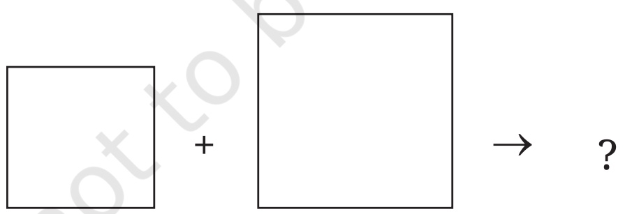

$$
\mathrm{S}0,(\sqrt{72})^{2}=2a^{2}
$$

$$
7 2 = 2 a ^ { 2 } .
$$

$$
\mathrm{Thus}, a^{2} = \frac{72}{2} = 36.
$$

$$
\mathrm{S}0, a = \sqrt{36} = 6.
$$

Therefore, each of the other two sides has length 6.

Use this formula to check your answers in the Figure it Out on page 39.

## 2.4 Combining Two Different Squares

We have seen in the previous sections how to combine two copies of the same square to make a larger square whose area is the sum of the areas of the two smaller squares.

The sidelength of the larger square is the length of the diagonal of either of the smaller squares.

？ What if we wish to combine two squares of ‘different’ sizes to make a large square whose area is the sum of the two smaller squares?

In his Śulba-Sūtra (Verse 1.12), Baudhāyana also gives a truly remarkable solution to this more general problem of combining two different sized squares. He writes:

The area of the square produced by the diagonal is the sum of the areas of the squares produced by the two sides.