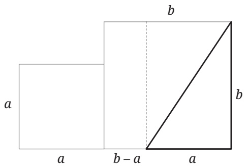
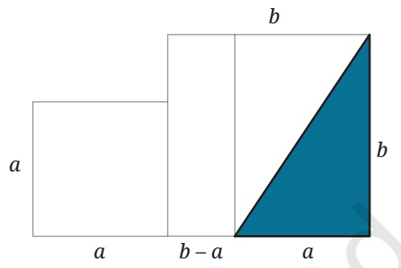
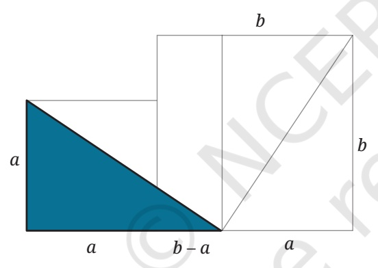
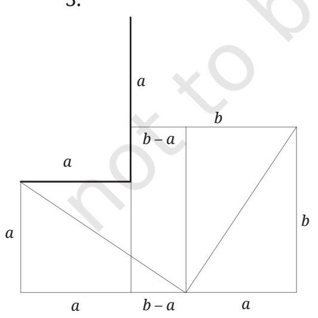
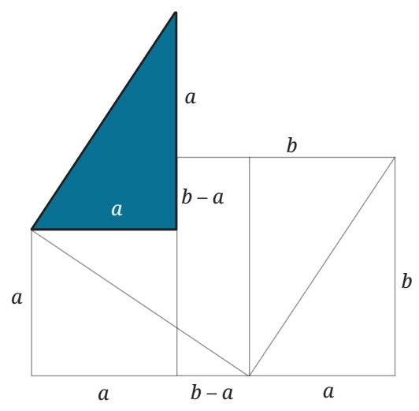

Mark a rectangular portion of the larger square using a side of the smaller one, and draw its diagonal. By doing this, we get a right triangle with perpendicular sides a and b.

1.

2.

Make a 4-sided figure over the hypotenuse by drawing three more of such right triangles:

3.

