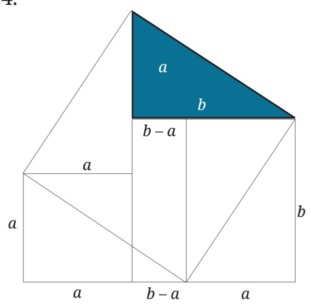
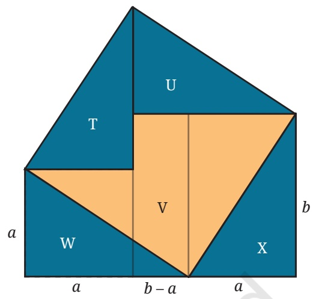
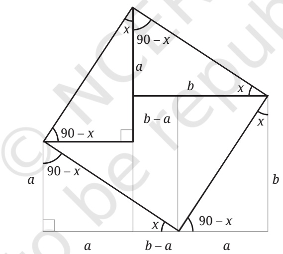

4.

The 4-sided figure obtained (T + U + V) is in fact a square with an area equal to the sum of the areas of the two smaller squares!

## ？ Why?

As T, U, X and W are all congruent, the sides of this new 4-sided figure all have the same length. Notice the angles.

？ Explain why all the angles of this new 4-sided figure are right angles and so it is a square.

Notice that this new square has as its sidelength, the hypotenuse of the right triangle of sides a and b.

• Baudhāyana’s assertion is now clear:

The area of the square on the hypotenuse = the sum of the areas of T, U, and V = the sum of the areas of V, W, and X = the sum of the areas of the two given squares.