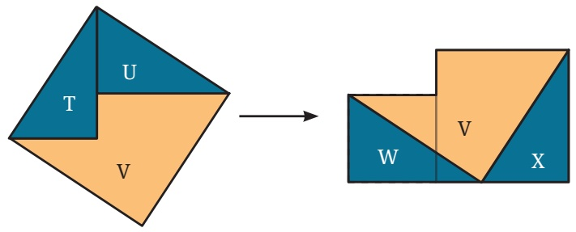
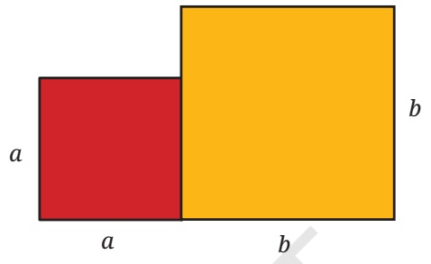
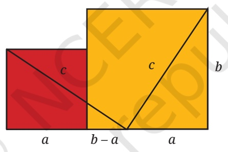
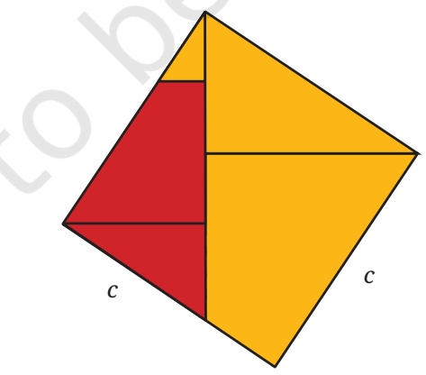

**Combining Two Squares Using Paper** Cut out and join two different sized squares as follows:

Now make two cuts to make three pieces:

Rearrange the three pieces into a larger square:

You have now combined two smaller squares into a larger square! Now make a right triangle using the two smaller squares. Draw a square on the hypotenuse.