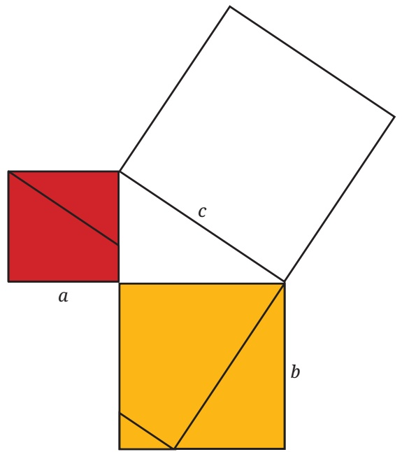
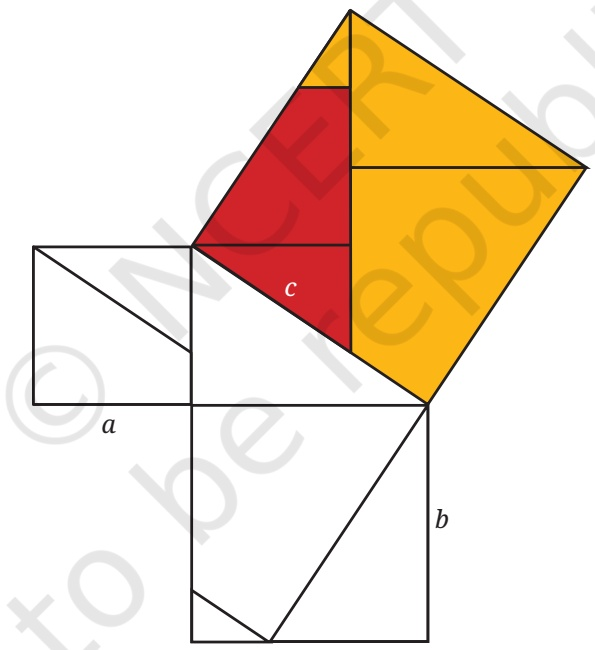

Cover the square on the hypotenuse using your pieces.

This shows that if a right triangle has shorter sides of length a and b, and hypotenuse of length c, then the areas of the two smaller squares, $a ^ { 2 }$ and $b ^ { \bar { 2 } } ,$ , add up to the area of the larger square, $c ^ { 2 }$

$$
a ^ { 2 } + b ^ { 2 } = c ^ { 2 } .
$$

This is the famous and fundamental theorem of Baudhāyana on right-angled triangles:

**Baudhāyana’s Theorem on Right-angled triangles:** If a right-angled triangle has sidelengths a, b, and c, where c is the length of the hypotenuse, then $a ^ { 2 } \stackrel { \smile } { + } b ^ { 2 } = c ^ { 2 }$