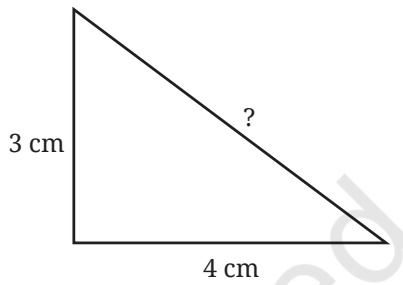

Baudhāyana was the first person in history to state this theorem in this generality and essentially modern form. The theorem is also known as the Pythagorean Theorem, after the Greek philosopher-mathematician Pythagoras (c. 500 BCE) who also admired and studied this theorem, and lived a couple hundred years after Baudhāyana. It is also often called the transitional name ‘Baudhāyana-Pythagoras Theorem’ so that everyone knows what theorem is being referred to.

## Using Baudhāyana’s Theorem

Make a right-angled triangle in your notebook whose shorter sidelengths are 3 cm and 4 cm. Now, measure the length of the hypotenuse. It should read about 5cm.

In fact, we could have used Baudhāyana’s Theorem to predict that the hypotenuse is exactly 5cm! Let a = 3 and b = 4, the lengths in cm of the two shorter sides. Then, by Baudhāyana’s Theorem, the length c of the hypotenuse satisfies the equation,

$$
a^{2} + b^{2} = c^{2}
$$

$$
3^{2} + 4^{2} = c^{2}
$$

$$
9 + 16 = c^{2}
$$

$$
25 = c^{2}
$$

$$
\mathrm{S}0,c=5\mathrm{cm}.
$$

## Figure it Out

1. If a right-angled triangle has shorter sides of lengths 5 cm and 12 cm, then what is the length of its hypotenuse? First draw the right-angled triangle with these sidelengths and measure the hypotenuse, then check your answer using Baudhāyana’s Theorem.

2. If a right-angled triangle has a short side of length 8 cm and hypotenuse of length 17 cm, what is the length of the third side? Again, try drawing the triangle and measuring, and then check your answer using Baudhāyana’s Theorem.

3. Using the constructions you have now seen, how would you construct a square whose area is triple the area of a given square? Five times the area of a given square? (Baudhāyana’s Śulba-Sūtra, Verse 1.10)

4. Let a, b and c denote the length of the sides of a right triangle, with c being the length of the hypotenuse. Find the missing sidelength in each of the following cases:

$$
a = 5,   b = 7
$$

$$
a = 8, b = 12
$$

$$
a = 9, c = 15
$$

$$
(iv) a = 7, b = 12
$$

$$
(v) a = 1.5, b = 3.5
$$