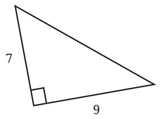
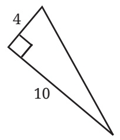
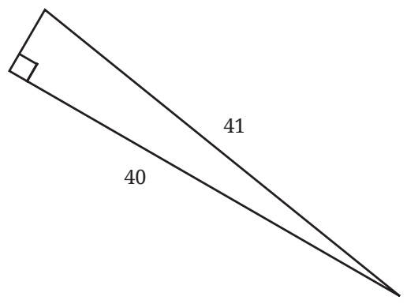
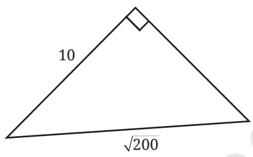
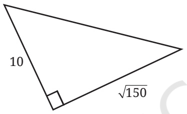
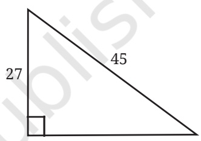
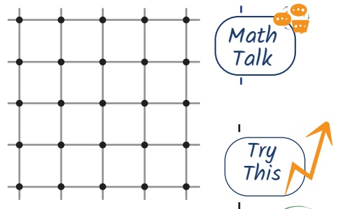

3. Find the sidelength of a rhombus whose diagonals are of length 24 units and 70 units.

4. Is the hypotenuse the longest side of a right triangle? Justify your answer.

5. True or False—Every Baudhāyana triple is either a primitive triple or a scaled version of a primitive triple.

6. Give 5 examples of rectangles whose sidelengths and diagonals are all integers.

7. Construct a square whose area is equal to the difference of the areas of squares of sidelengths 5 units and 7 units.

8. (i) Using the dots of a grid as the vertices, can you create a square that has an area of (a) 2 sq. units, (b) 3 sq. units, (c) 4 sq.units, and (d) 5 sq. unit?

(ii) Suppose the grid extends indefinitely. What are the possible integer-valued areas of squares you can create in this manner?

