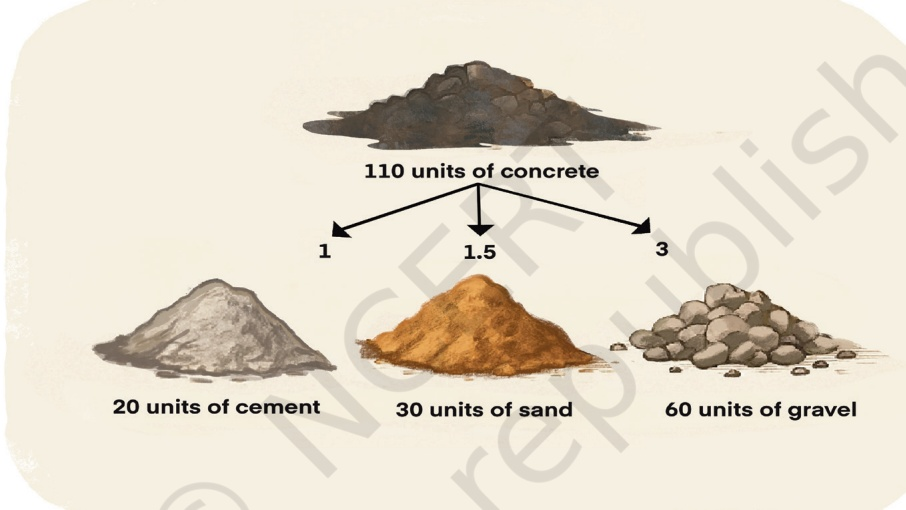

We can extend this to ratios with multiple terms.

Let us look at the earlier example of making a concrete mixture. We need to mix cement, sand, and gravel in the ratio of 1 : 1.5 : 3 to get the concrete.

## ？ Example 3: For some construction, 110 units of concrete are needed. How many units of cement, sand, and gravel are needed if these are to be mixed in the ratio 1 : 1.5 : 3?

For 1 unit of cement, we need to add 1.5 units of sand and 3 units of gravel. Together, they add up to 5.5 units of concrete. We need to do this 20 times $(110 \div 5.5 = 20)$ to get 110 units of concrete. So each term has to be multiplied by 20.

$$
\begin{array} { c } { { 1 \times 2 0 = 2 0 \; \mathrm { u n i t s \; o f \; c e m e n t } , } } \\ { { 1 . 5 \times 2 0 = 3 0 \; \mathrm { u n i t s \; o f \; s a n d , \; a n d } , } } \\ { { 3 \times 2 0 = 6 0 \; \mathrm { u n i t s \; o f \; g r a v e l } . } } \end{array}
$$

So, we need 20 units of cement, 30 units of sand, and 60 units of gravel to make the concrete.

When we divide a quantity x in the ratio $a : b : c : \dots ,$ the terms in the ratio are —

$\begin{aligned}\overline{X} \times \frac{a}{(a + b + c + \cdots)}, \overline{X} \times \frac{b}{(a + b + c + \cdots)}, \overline{X} \times \frac{c}{(a + b + c + \cdots)}\end{aligned}$ , and so on.

？ **Example 4:** You get a particular shade of purple paint by mixing red, blue, and white paint in the ratio 2 : 3 : 5. If you need 50 ml of purple paint, how many ml of red, blue, and white paint will you mix together?

$$
\mathrm{Red}\;\mathrm{point}=50\times\frac{2}{(2+3+5)}=50\times\frac{2}{10}=10\;\mathrm{ml}.
$$

$$
\mathrm{Blue\ paint} = 50 \times \frac{3}{(2 + 3 + 5)} = 50 \times \frac{3}{10} = 15\ \mathrm{m}
$$

$$
\mathrm{While\ point}=50\times\frac{5}{(2+3+5)}=50\times\frac{5}{10}=25\mathrm{~ml}.
$$