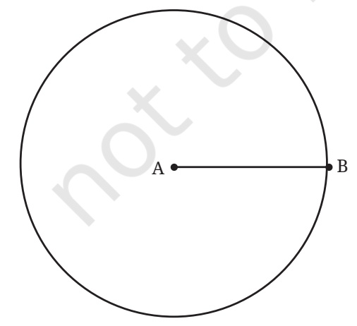
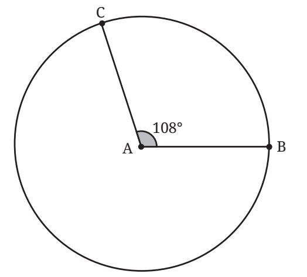

## ？ How do we mark the different slices of the pie chart?

To mark a slice in the pie chart, the angle corresponding to a grade should be proportional to the number of students who have scored that grade. The total angle in a circle is 360°. So, we need to divide 360 in the ratio of $1 2 : 1 0 : 8 : \bar { 6 } : 4 .$

## Can we reduce this ratio to its simplest form?

We can use the same procedure we used to reduce a ratio with two terms to its simplest form. We divide all the terms by their HCF to get the simplest form.

In this example, 2 is the HCF of the terms. We get the simplest form by dividing all the terms by 2. The ratio becomes 6 : 5 : 4 : 3 : 2.

So, the angles are:

$$
\mathrm{Grade}A=\frac{6}{(6+5+4+3+2)}\times360^{\circ}=\frac{6}{20}\times360^{\circ}=6\times18=108^{\circ}
$$

Grade $\mathrm{B}=\frac{5}{(6+5+4+3+2)} \times 360^{\circ}=5 \times 18=90^{\circ}.$

Grade C = 4 × 18 = 72°.

Grade D = 3 × 18 = 54°.

Grade $\mathbb{E} = 2 \times 18 = 36^{\circ}.$ .

Now let us construct a pie chart using these angles.

## Step 1: Draw a circle and mark the radius AB as shown below:

Step 2: To draw the slice to represent the proportion of students who got an A grade, measure 108° from the segment AB on A (anti-clockwise), and mark the new radius AC.

