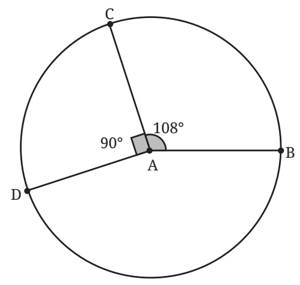
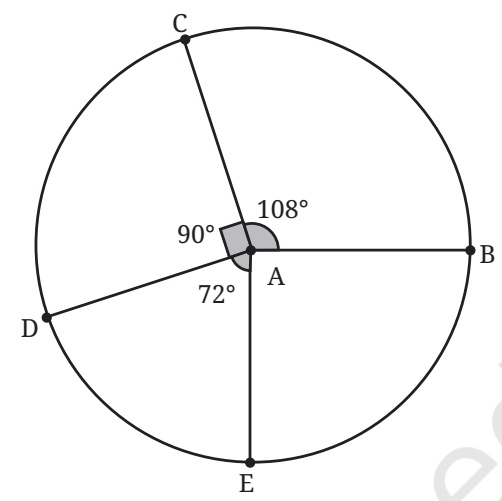
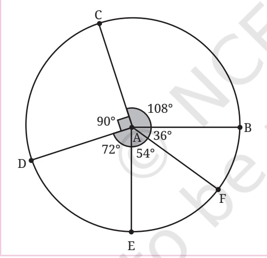
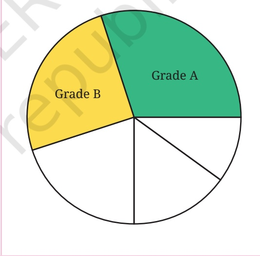

<table><tr><td></td><td></td></tr><tr><td>Steps 5,6: Similarly, we can</td><td>Step 7: You can colour and label</td></tr><tr><td>complete the rest of the pie chart.</td><td colspan="2">the different slices of the pie chart appropriately.</td></tr><tr><td></td><td colspan="2"></td></tr><tr><td></td><td colspan="2"></td></tr></table>

Step 3: Measure $9 0 ^ { \circ }$ 90° from AC and draw AD.

Step 4: Measure $7 2 ^ { \circ }$ from AD and draw AE.

## Figure it Out

1. A group of 360 people were asked to vote for their favourite season from the three seasons — rainy, winter and summer. 90 liked the summer season, 120 liked the rainy season, and the rest liked the winter. Draw a pie chart to show this information.

2. Draw a pie chart based on the following information about viewers favourite type of TV channel: Entertainment — 50%, Sports — 25%, News — 15%, Information — 10%.

3. Prepare a pie chart that shows the favourite subjects of the students in your class. You can collect the data of the number of students for