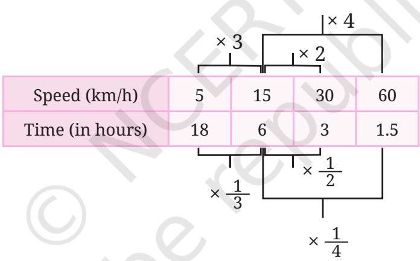

Does it decrease by the same rate (or factor)?

Going by bicycle is 3 times faster than walking $( 1 5 \div 5 )$ . The speed has increased 3 times. The travel time has decreased 3 times too $( 1 8 \div 6 )$ The speed has increased by the same factor by which the travel time has decreased.

## Check if this is the case for the other modes of transport.

Since both quantities, speed and time, change by the same factor, they are proportional. But they change in opposite directions, or inversely. Such proportions are called **inverse proportions**.

From the table, we can see that the product of speed and time are the same for all modes of transport, namely 90 km.

relation of the type $x y = k ,$ where k is a constant.

In the previous example, if x represents the speed and y represents the time taken, then k is the distance between Lucknow and Kanpur, which remains constant.

Thus, if quantities x and y are inversely proportional, and $X _ { 1 }$ and $X _ { 2 }$ are values of x that have corresponding y values $y _ { 1 }$ and $y _ { 2 ^ { \circ } }$ then

$$
x_{1}y_{1}=x_{2}y_{2}=k ( some constant ).
$$

From these we can see that $\frac { \overline { { X } } _ { 1 } } { X _ { _ 2 } } = \frac { \overline { { y } } _ { 2 } } { \overline { { y } } _ { 1 } }$

Let us check if this is true for other modes of transport, such as walking and by car. Let us use x to represent speed and y to represent time.

$$
x_{1}=5,x_{2}=60,y_{1}=18,y_{2}=1.5.
$$

$$
\begin{array} { r } { \frac { X _ { _ 1 } } { X _ { _ 2 } } = \frac { 5 } { 6 0 } = 0 . 0 8 3 3 3 3 . . . } \end{array}
$$

What is the value of $\frac { 1 . 5 } { 1 8 }   \bigg ( \cfrac { y _ { 2 } ^ { } } { y _ { 1 } ^ { } } \bigg ) ?$ It is 0.083333... too!