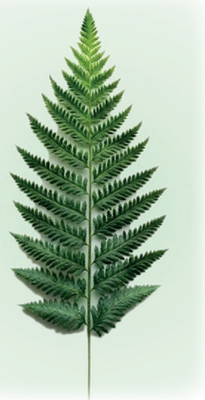
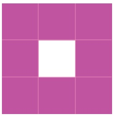
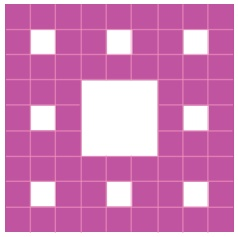

In this chapter, we will explore two geometric themes. We will study fractals which are self-similar shapes. They exhibit the same or similar pattern over and over again — but at smaller and smaller scales. We will then look at different ways of visualising solids.

## 4.1 Fractals

One of the most beautiful examples of a fractal that also occurs in nature is the fern. The fern is seen to have smaller copies of itself as its leaves, and these in turn have even smaller copies of themselves in their sub-leaves, and so on!

Similar phenomena of self-similarity occur in trees (where a trunk has limbs, and a limb has branches, and the branches have branchlets, and so on), clouds, coastlines, mountains, lightning, and many other objects in nature.

Other mathematical fractals can also be very beautiful. We will explore some of them here.

## Sierpinski Carpet

The Polish mathematician Sierpinski discovered a type of fractal known as the **Sierpinski Carpet**. It is made by taking a square, breaking it into 9 smaller squares, and then removing the central square (see the figure below); the same procedure is then repeated on the remaining 8 squares, and so on. One then sees the same pattern at smaller and smaller scales.

Step 0

Step 1

Step 2