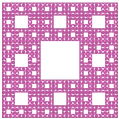

Sierpinski Carpet

？ Draw the initial few steps (at least till Step 2) of the shape sequence that leads to the Sierpinski Carpet.

By its construction, each step in the sequence has

(i) squares of the same size that remain in the figure, and the size of these squares becomes smaller and smaller as the step number increases, and

(ii) square holes that are formed by removing square pieces.

？ Do you see any pattern in the number of holes and squares that remain at each step?

Let $R _ { n }$ represent the number of remaining squares at the nth step, and $H _ { n }$ represent the number of holes at the nth step.

Let us understand how these numbers grow by analysing how the holes and squares that remain are generated from the previous step.

Every square that remains at a given step, say Step n, gives rise to 8 squares that remain at the (n + 1)th step. Thus, we have

$$
R_{n + 1} = 8 R_n
$$

Can this be used to get a formula for $R _ { n ^ { \sharp } }$

We have

$$
\begin{array} { l } R _ { 0 } = 1 \\ R _ { 1 } = 8 \times 1 = 8 \\ R _ { 2 } = 8 \times 8 = 8 ^ { 2 } . \end{array}
$$

In general, $R _ { _ n } = 8 _ { _ \odot } ^ { n }$

Similarly, how do we find the number of holes at a given step?

Every square that remains at the nth step gives rise to a hole in the (n + 1)th step. All the holes present at the nth step remain in the (n + 1)th step as well. Thus,

So we have

$$
\begin{array} { c } { { H _ { _ { n \; + \; 1 } } = H _ { _ { n } } + R _ { _ { n } } . } } \\ { { } } \\ { { R _ { _ { 0 } } = 1 } } \\ { { R _ { _ { 1 } } = 8 } } \\ { { R _ { _ { 2 } } = 8 ^ { 2 } } } \\ { { R _ { _ { 3 } } = 8 ^ { 3 } } } \end{array} \begin{array} { c } { { H _ { _ { 0 } } = 0 } } \\ { { H _ { _ { 1 } } = 1 } } \\ { { H _ { _ { 2 } } = 1 } } \\ { { H _ { _ { 3 } } = 1 + 8 } } \\ { { H _ { _ { 3 } } = 1 + 8 + 8 ^ { 2 } } } \end{array}
$$