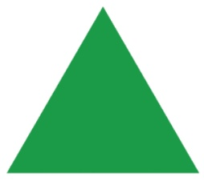
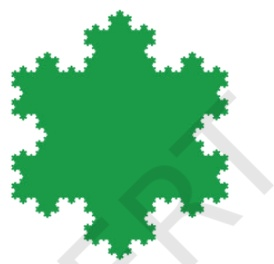

## Koch Snowflake

The Koch Snowflake is another fractal, named after the Swedish mathematician Von Koch, who first described it in 1904. We have already encountered this fractal in Grade 6, Ganita Prakash.

Step 0

Step 1

Step 2

Koch Snowflake

To generate it, we start with an equilateral triangle. Each side is

(i) divided into 3 equal parts, and

(ii) an equilateral triangle is raised over the middle part, and then the middle part is removed.

Effectively, each side gets replaced by a ‘bump’ - shaped structure . This procedure is repeated on the sides of the new resulting shape, and so on.

## Figure it Out

1. Draw the initial few steps (at least till Step 2) of the shape sequence that leads to the Koch Snowflake.

2. Find the number of sides in the nth step of the shape sequence that leads to the Koch Snowflake.

3. Find the perimeter of the shape at the nth step of the sequence. Take the starting equilateral triangle to have a sidelength of 1 unit.