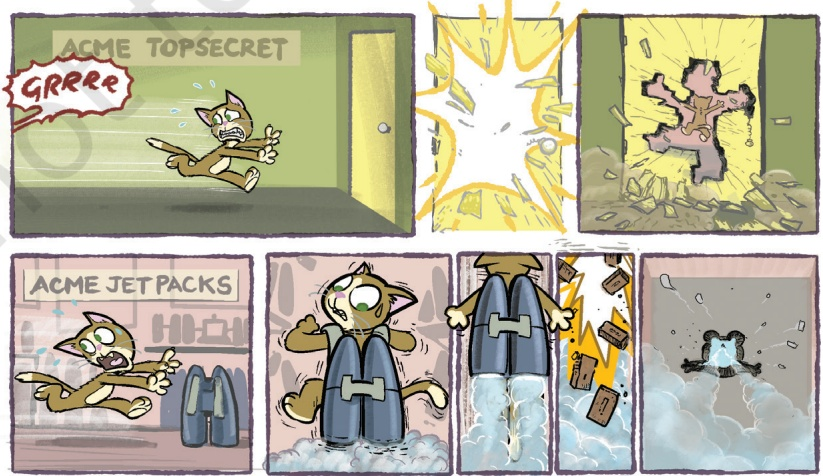

2. Cut off the four corners of an imaginary square, with each cut going between midpoints of adjacent edges. What shape is left over? How can you reassemble the four corners to make another square?

3. Mark the sides of an equilateral triangle into thirds. Cut off each corner of the triangle, as far as the marks. What shape do you get?

4. Mark the sides of a square into thirds and cut off each of its corners as far as the marks. What shape is left?

When we see a solid object, we are really seeing its **profile** from a specific viewpoint. Depending on our viewpoint, the **outline** of this profile can vary dramatically!

Perhaps you’ve noticed interesting profiles of objects yourself, while taking a photograph or observing the shadow of an object? Or, maybe you’ve seen a cartoon like the following, in which a character bursts through a wall and leaves a hole shaped like their outline!