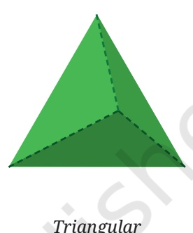
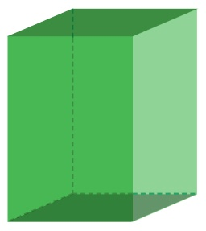
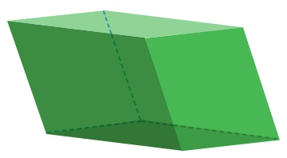
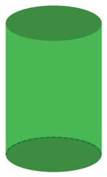
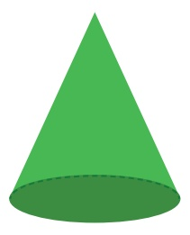
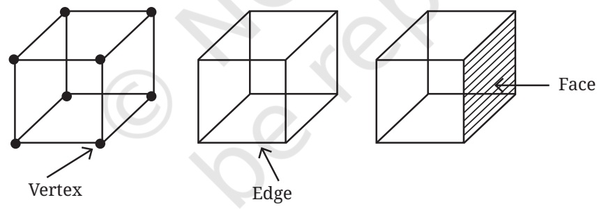
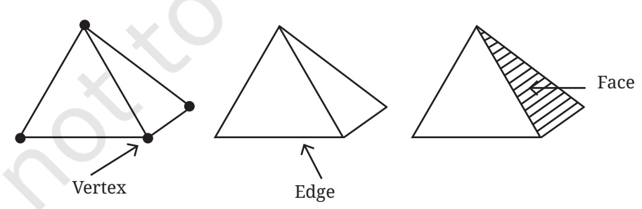

Cuboid

Parallelopiped

Cylinder

Cone

Triangular prism

Triangular pyramid

While discussing solids that contain plane surfaces in their boundaries, the notion of faces, edges and vertices serves a useful purpose.

**Faces** are the plane/flat surfaces of a solid that form its boundary. **Edges** are the line segments that form the sides of the faces, and **vertices** are the points at which the edges meet. For example, a cuboid or cube has 6 faces, 12 edges and 8 vertices.