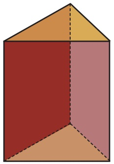
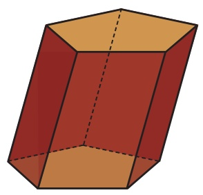
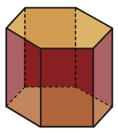
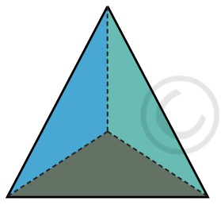
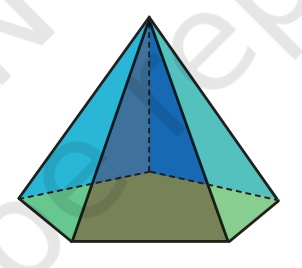
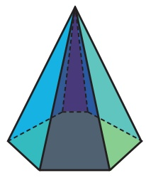

There are multiple types of prisms and pyramids, whose names depend on the shapes of their faces.

Triangular Prism

Pentagonal Prism

Hexagonal Prism

**Prism:** A prism, in general, has two congruent polygons as opposite faces, with edges connecting the corresponding vertices of these polygons. All the other faces are parallelograms. Based on the shape of the congruent polygons, prisms may be called triangular prisms, pentagonal prisms, and so on.

**Pyramids:** A pyramid, in general, has a polygonal base and a point outside it, and edges connect the point with each of the vertices of the base. Based on the shape of the base, pyramids may be called triangular pyramids, square pyramids, pentagonal pyramids, and so on. A triangular pyramid is also known as a **tetrahedron**.

Triangular Pyramid

Pentagonal Pyramid

Hexagonal Pyramid

？ If the congruent polygons of a prism have 10 sides, how many faces, edges and vertices does the prism have? What if the polygons have n sides?

？ If the base of a pyramid has 10 sides, how many faces, edges and vertices does the pyramid have? What if the base is an n-sided polygon?

Now we will see how to make different solids using a foldable flat surface such as paper, cardboard, etc.

The basic idea is to create a shape on a flat surface that can be folded into the solid. Such a shape is called a **net**. In other words, a net is obtained by ‘unfolding’ a solid onto a plane.