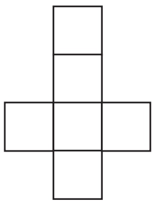
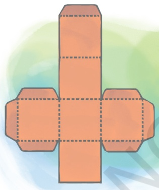
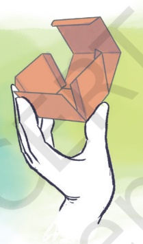
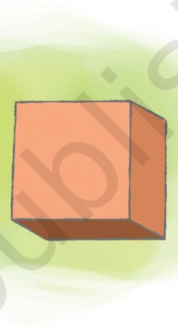
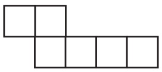
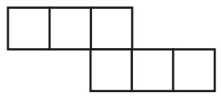
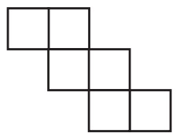

## ？ What is a net of a cube?

Fig. 4.1 is a net of a cube.

？ Visualise how it can be folded to form a cube.

## Practical Aspects of Using a Net

To make an actual cube from its net, certain practical aspects have to be kept in mind. One is that the material used must have sufficient sturdiness for the cube to stand. The second aspect is that there should be some

Fig. 4.1

mechanism for attaching the faces together. If cardboard or a similar material is used, cello tape is one way to join the adjacent faces. For less sturdy materials, such as chart paper, it is useful to have extra ‘flaps’ on some of the faces that can be stuck to the adjacent faces. You might have observed this strategy in packaging boxes.

(i)

(ii)

(iii)

However, when we talk about the net of a solid, we consider only the shape formed by unfolding the solid, and not the other supporting flaps that we may use to actually make the solid.

Apart from using a net, there are other ways to make a cube from paper.

There are multiple possible nets one can use to build a cube.

## Figure it Out

1. Which of the following are the nets of a cube? First, try to answer by visualisation. Then, you may use cutouts and try.

(i)

(ii)

(iii)