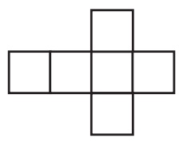

(iv)

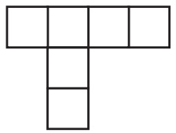

(v)

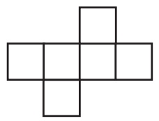

(vi)

2. A cube has 11 possible net structures in total. In this count, two nets are considered the same if one can be obtained from the other by a rotation or a flip. For example, the following nets are all considered the same —

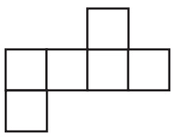

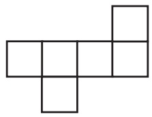

Find all the 11 nets of a cube.

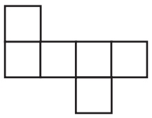

3. Draw a net of a cuboid having sidelengths:

(i) 5 cm, 3 cm, and 1 cm

(ii) 6 cm, 3 cm, and 2 cm

Let us find out the nets of other solids.

A tetrahedron whose faces are equilateral triangles is called a regular **tetrahedron**.

？ What is a net of a regular tetrahedron? Which of the following are nets of a regular tetrahedron?

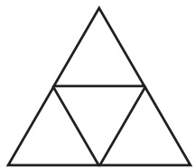

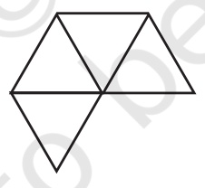

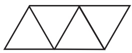

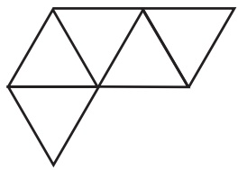

？ Are there any other possible nets?

A regular tetrahedron has only 2 possible nets.

？ Draw a net with appropriate measurements that can be folded into a regular tetrahedron. Verify if it works by making an actual cutout.

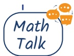

？ Draw a net with appropriate measurements that can be folded into a square pyramid. Verify if it works by making an actual cutout.