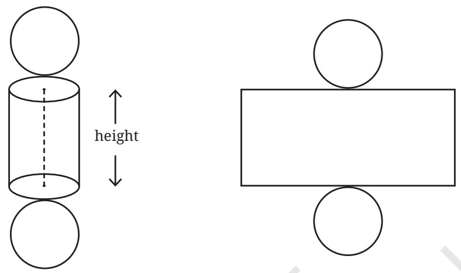
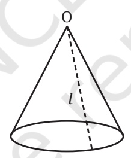
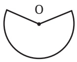

## ？ What is the net of a cylinder?

If the circular faces of a cylinder are unfolded, and if a cut is made along the height of the cylinder, as shown in the figure below, then we get

？ What are the sidelengths of the rectangle obtained?

？ How will the net of a cone look?

？ If the cone is slit open along the line l and then unrolled, what will we get?

Observe that all the points on the boundary of the base circle are at equal distances from ‘O’. So after unrolling the cone, the boundary of the net will be a portion of a circle with centre O.

？ What surface do you construct by using the above net, in which O is not the centre of the boundary circle? Make a physical model to help you answer this question!

？ Draw a net with appropriate measurements that can be folded into a triangular prism. Verify that it works by making an actual cutout.