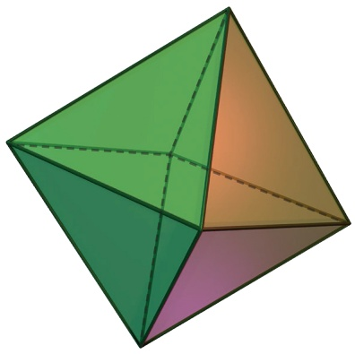
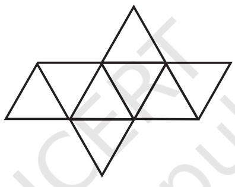
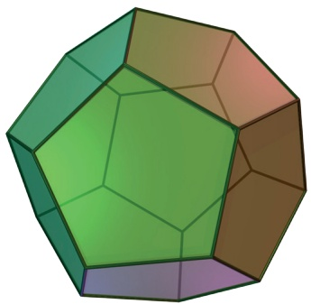

Octahedron

Here is a solid called the **octahedron**, made by joining two square pyramids at their square bases.

Can you visualise its net? This is one of its nets.

？ Taking all the triangles in the net to be equilateral, make a cutout of the net and fold it to form an octahedron.

As in the case of cubes, an octahedron too has 11 different nets.

So far, we have seen solids whose faces are all equilateral triangles (regular tetrahedrons), and all squares (cubes). Does there exist a solid whose faces are all pentagons? Interestingly, the answer is yes!

This solid is called a **dodecahedron**. This solid too can be made from a net! Mathematicians have been even able to determine exactly how many nets a dodecahedron has — 43,380.

Dodecahedron