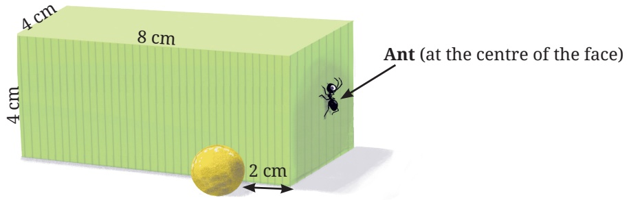
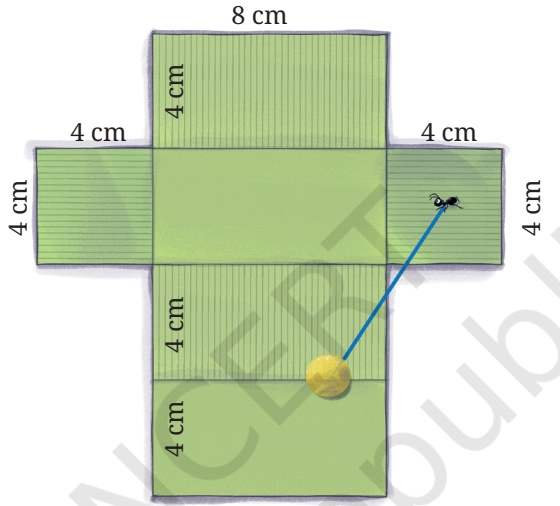
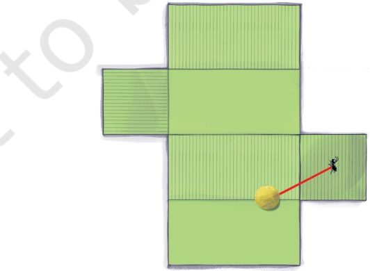

Ant (at the centre of the face)

## ？ Find the shortest path between the ant and the laddu in the following case:

If we unfold the cuboid as before, we get

Notice the line segment between the ant and laddu going outside the net! Obviously, this does not correspond to any path on the cuboid.

## So what do we do now?

cuboid.

The shortest path

Thus, the way a cuboid is unfolded matters!