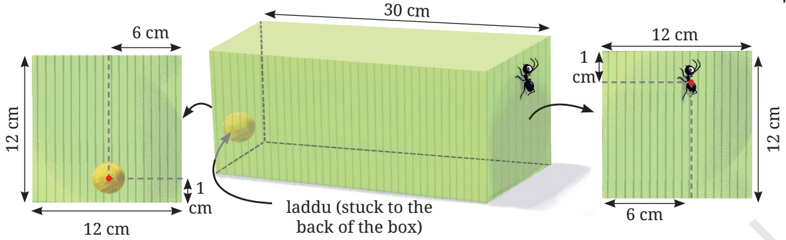
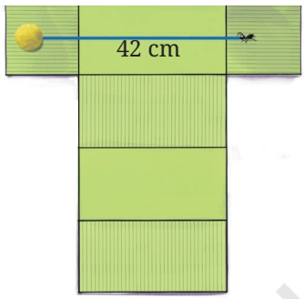
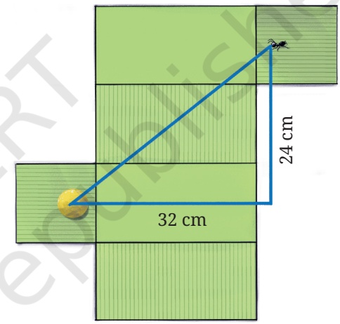

Now we will look at a trickier case.

？ What is the length of the shortest path between the ant and the laddu?

Here are some of the ways of unfolding the cuboid.

In the second case, the distance d between the ant and the laddu can be calculated using the Baudhayana Theorem, since we have a right triangle here.

$$
d ^ { 2 } = 2 4 ^ { 2 } + 3 2 ^ { 2 }
$$

$$
d = \sqrt{1600} = 40   cm
$$

We see that in each of these unfoldings, the lengths of the line segments between the ant and the laddu are different! So we have to carefully list all the possible different unfoldings to find the answer!

## Representation of Solids on a Plane Surface

Drawing is one of the oldest human activities. People have been doing it for thousands of years for both aesthetic as well as practical and engineering purposes. Regarding the latter, making a drawing of an object is a useful way to record or convey information about it. Visual representation also helps us in thinking about the objects being represented. Such needs often arise in engineering — while constructing buildings, designing machines, etc. Further, engineering drawings need