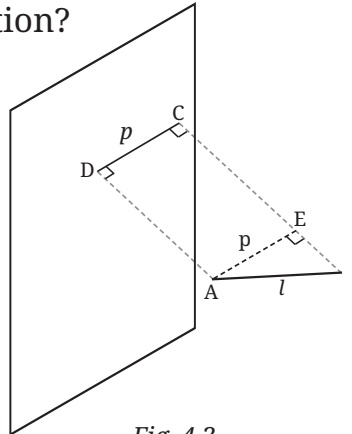
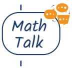
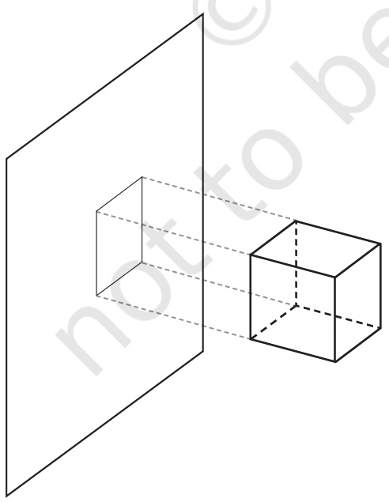
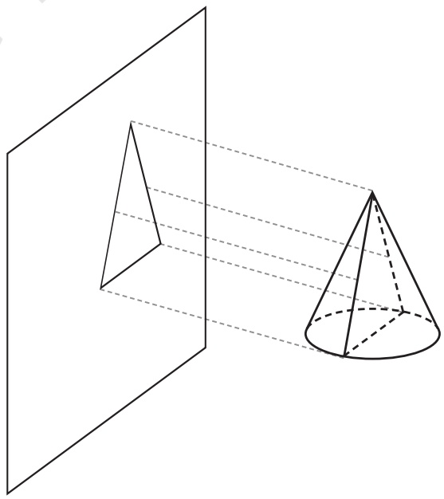

？ What happens to the length of a line in its projection?

Let us consider projections in Fig. 4.3. For example let l be the actual length of the line and $p$ be the length of its projection.

Draw AE ⊥ BC. AECD is a rectangle (why?). So, $AE = DC = p.$ Also, $\angle  AEB = 90^{\circ}$

Can you now compare the lengths p and l?

？ When is the length of the projected line equal to its actual length?

Fig. 4.3

？ What do you think are the different possible projections of a square that we get based on its orientation?

？ What do you think is the projection of a parallelogram under different orientations?

Can this ever be a quadrilateral that is not a parallelogram? As a starting point, you could think about the projection of a pair of parallel lines.

? What can you say about the projection of an n-sided regular polygon? [**Hint:** Projection of a polygon is composed of the projections of its sides.]

Let us consider projections of solids now.

？ How would the projections of a cube and a cone look?

Fig. 4.4

Fig. 4.5