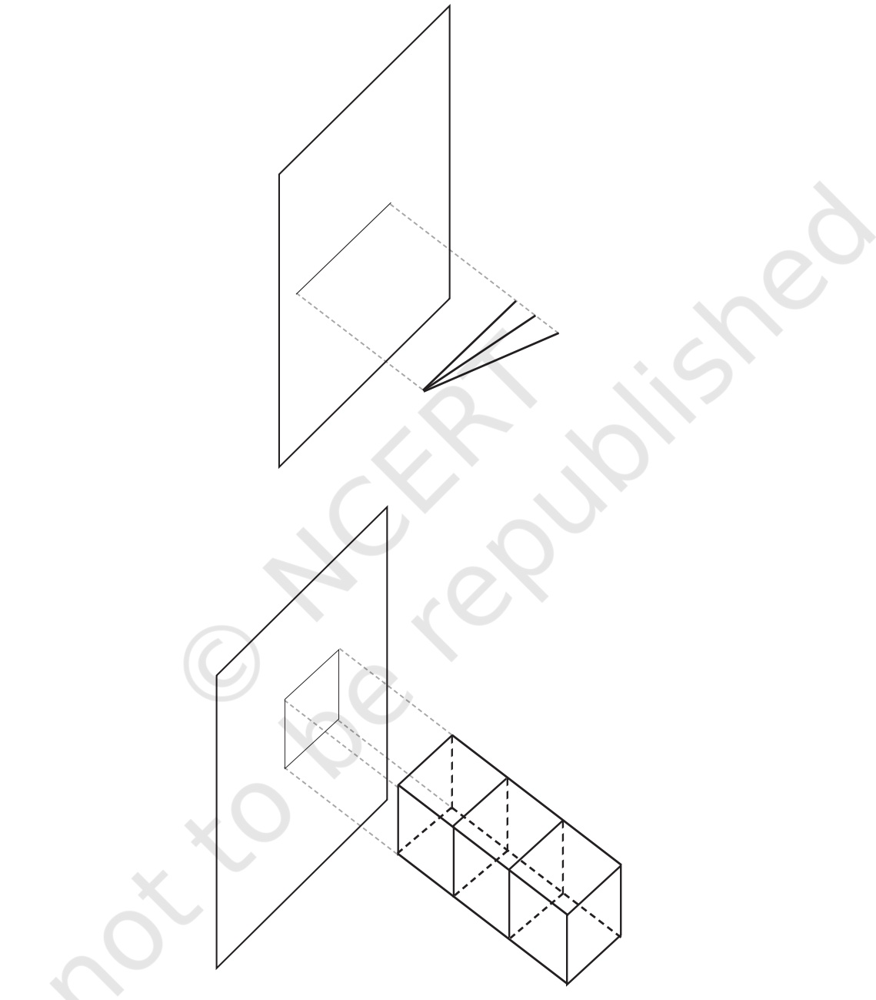

If an object were to pass perpendicularly through a plane and form a hole, the shape of the hole would be the same as the shape of the projection of the object.

? See Figures 4.2 – 4.5. In each case, see if you can visualise another object that gives the same projection.

Fig. 4.6

Different lines and different cuboids giving the same projections

We see that a given projection is not made by a unique object.