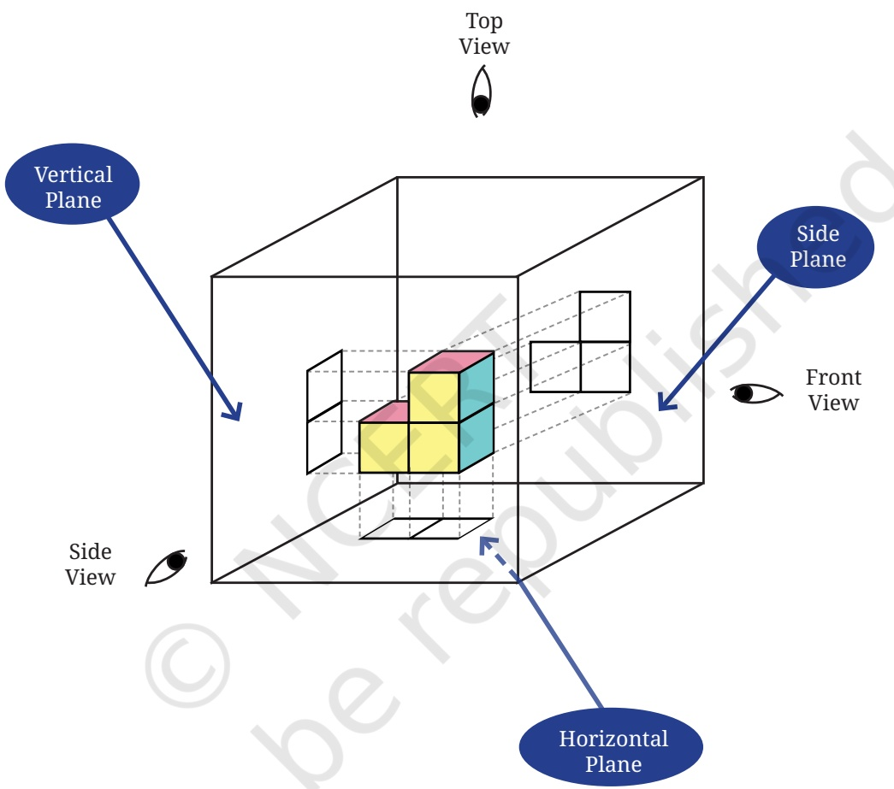

? Find another object that makes the same projection as that of a given cone.

For this reason, we often take three mutually perpendicular projections of an object. As shown in the figure, we consider a plane in front of the object called the **vertical plane**, a plane below the object called the **horizontal plane** and a plane to the side of the object called the **side plane**.

We give names to the projections on these three planes based on the directions from which the object is viewed. The projection on the vertical plane is called the **front view**, on the horizontal plane the **top view** and on the side plane the **side view**. These projections formalise the notion of profiles that we explored in an earlier section.

？ Let us see what these projections are for the objects shown in Fig. 4.6, when the planes shown are taken to be vertical planes.

Projections of the different lines in Fig. 4.6 —