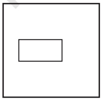
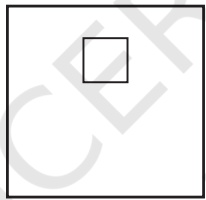
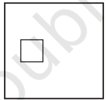
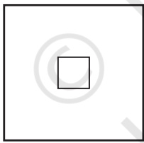
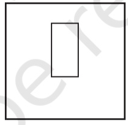
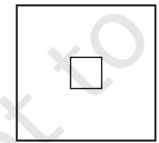
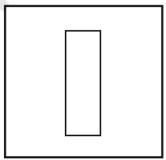
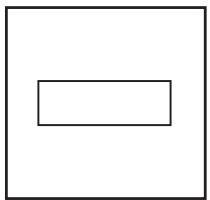

Front View

Top View

Side View

Projections of the different cuboids in Fig. 4.6 —

Front View

Top View

Side View

## Figure it Out

1. Observe the front view, top view and side view of the different lines in Fig. 4.6. Is there any relation between their lengths?

2. Find the front view, top view and side view of each of the following solids, fixing its orientation with respect to the vertical, horizontal and side planes: cube, cuboid, parallelepiped, cylinder, cone, prism, and pyramid. If needed, see the next problem for clues.