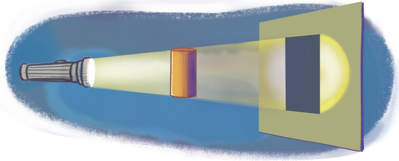

## Shadows

Place an object in front of a plane, such as a wall of your room. Shine a torch light on the object in a direction perpendicular to the wall.

## ？ What do you see?

We will see that the shape of the shadow on a plane is quite similar to the shape of the projection on that plane! However the shadow may be scaled up, stretched, or even distorted slightly, depending on how the object is held.

？ Observe what happens to the size of the shadow as you vary the distance between your torch and your object.

## ？ Why does this happen?

Now, imagine your torch is extremely powerful and will continue casting a shadow of the object on the wall, no matter how far back you move it.

If this imaginary torch always points in a direction perpendicular to the wall, then, as the distance between the torch and the object increases, the shadow of the object will become indistinguishable from the projection of the object to the wall plane!

Although this experiment may sound fanciful, you have encountered one such extremely powerful and distant torch before … namely, the Sun! Indeed, when sunlight is perpendicular to a plane, the shadows it casts on that plane are indistinguishable from projections!

Earlier we asked what the projection of a parallelogram might look like. You can now physically answer this question by making a cutout of a parallelogram and viewing its shadows under sunlight. No matter how you orient the parallelogram, you will see that the shadow remains a parallelogram!

More generally, the projection of a pair of parallel lines will always remain parallel.