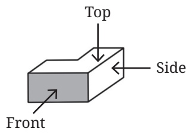
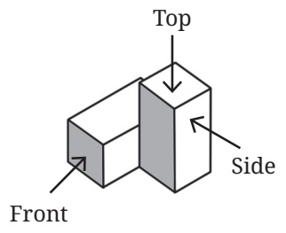
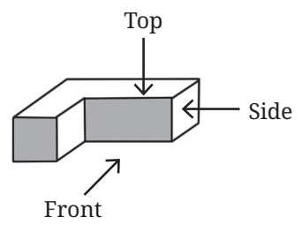
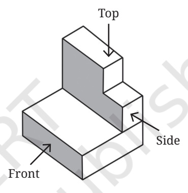
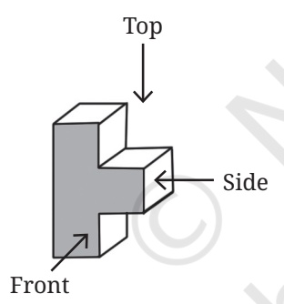
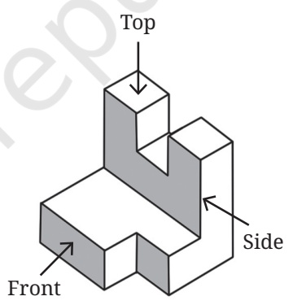
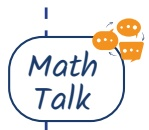

This property is useful for drawing projections of objects.

## Figure it Out

1. Draw the top view, front view and the side view of each of the following combinations of identical cubes.

2. Imagine eight identical cubes, glued together along faces to form the letter $\mathbb { E } ;$

(i) This looks like a $世 ^{\circ}$ from the front. What does it look like from the side? From the top?

(ii) Glue additional cubes to make a shape that looks like ‘from the front and ‘ from the top.

(iii) Now, can you glue even more cubes to make it look like from the front, $髁$ from the top, and $锟$ from the side?

(iv) Can you think of other letter combinations to make with a single combination of cubes in this manner?