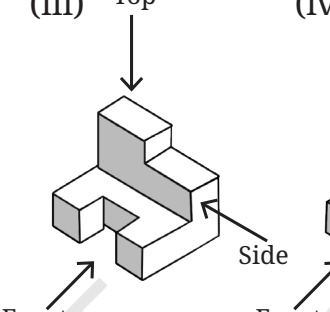

Front

3. Which solid corresponds to the given top view, front view, and side view?

Front View

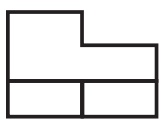

Top View

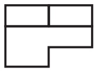

Side View

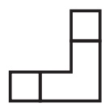

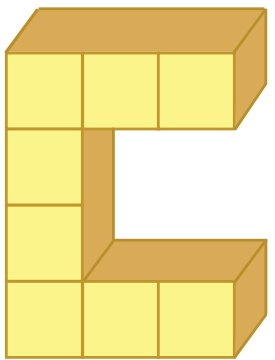

(i)

Top

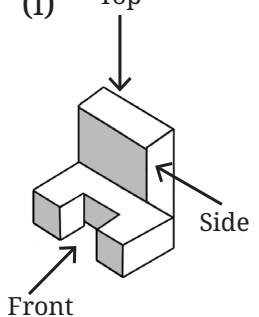

(ii)

Top

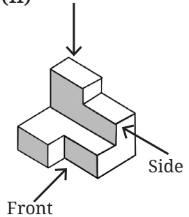

(iii)

Front

Top

(iv)

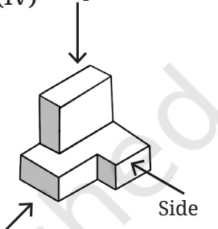

(v)

Top

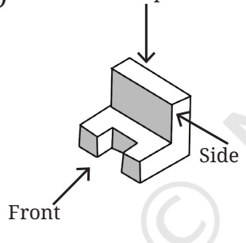

Top (vi)

Front

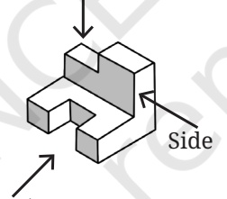

(vii)

Side

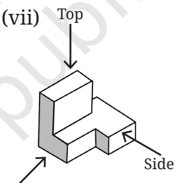

Front

4. Using identical cubes, make a solid that gives the following projections.

(i)

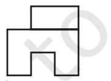

Top View

(ii)

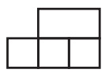

Front View

(iii)

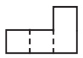

Side View

(iv)

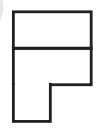

Top View

(v)

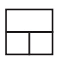

Front View

(vi)

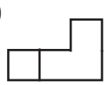

Side View

(vii)

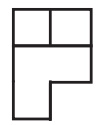

Top View

(viii)

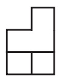

Front View

(ix)

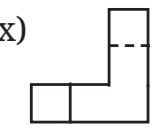

Side View