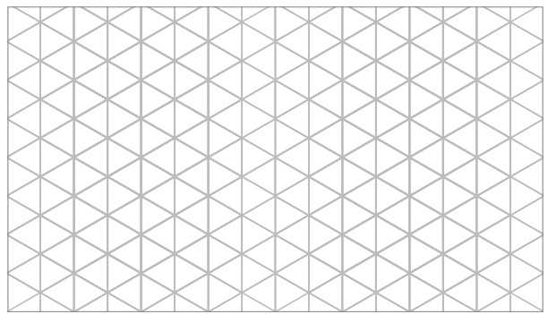
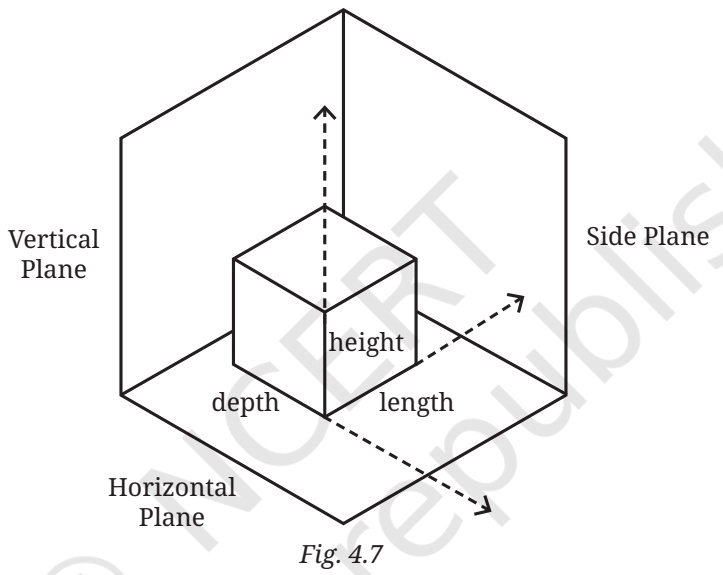
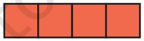
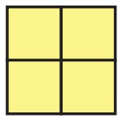
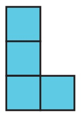
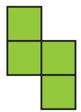
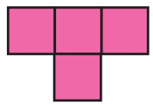

Isometric grids are widely used in engineering. They make it easy to draw projections of solids and to measure lengths along all the 3 primary directions — length, depth and height, as shown in Fig. 4.7.

**Drawing on Isometric Grids**

？ Have you played Tetris? There are five basic shapes in Tetris, corresponding to the different ways of arranging four squares.

(i)

(ii)

(iii)

(iv)

(v)

Fig. 4.8