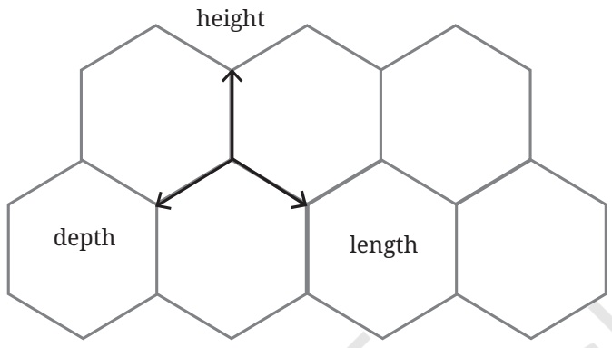
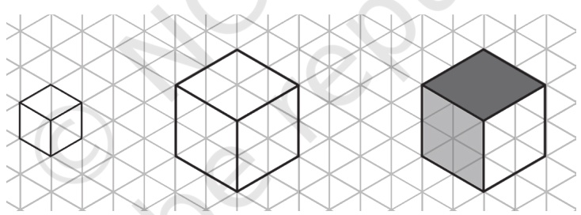
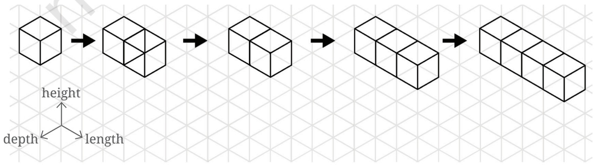

## ？ Imagine these are cubes, not squares. Draw each of these on your isometric paper (you can find it at the end of the book).

As seen in Fig. 4.7, there are three principal axes of the solid shape, which we will call the depth axis, length axis, and height axis.

The edges of the grid appear in three different orientations:

$/ , \setminus$ and |. We will associate height to | , depth to $\prime$ , and length to .

While drawing on the grid, it may be useful to draw edge by edge, counting the number of units you want to go along a given axis.

For example, you can draw a 1 × 1 × 1 cube as follows. How would you draw a $2 \times 2 \times 2$ cube? Feel free to add shading, if it helps you visualise the solid.

The first tetris shape is a row of four cubes joined face-to-face. In order to draw this solid, you will need to choose an orientation for the row of four cubes.

Let’s draw it oriented along the depth axis. You could draw it cube-by-cube, but in that case you may need to erase the lines that get hidden by additional cubes. (If you don’t have an eraser, you can also draw faint lines initially, and then darken the visible ones later.)

