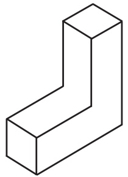
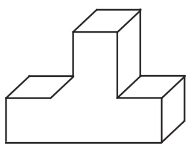
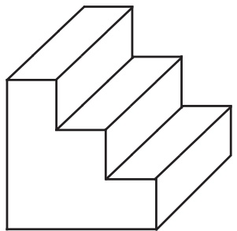
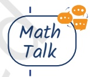
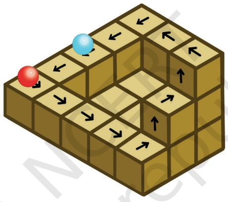
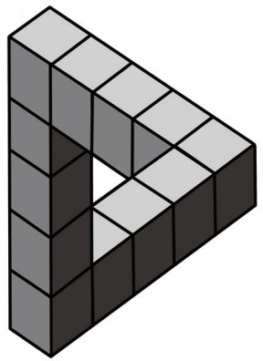

2. Draw the following figures on the isometric grid.

[**Hint:** It may be useful to determine whether the edge to be currently drawn — say, along the height — goes from down to up or up to down. Accordingly, draw the line segment on the grid either in the direction of the height axis or opposite to it.]

3. Is there anything strange about the path of this ball? Recreate it on the isometric grid.

[**Hint:** Consider a portion of this figure that is physically realisable and identify the 3 primary directions.]

4. Observe this triangle.

(i) Would it be possible to build a model out of actual cubes? What are the front, top, and side profiles of this impossible triangle?