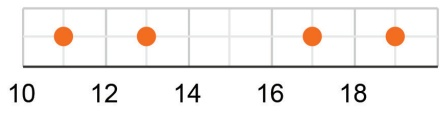
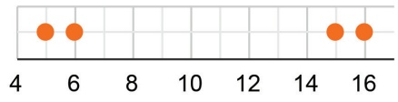
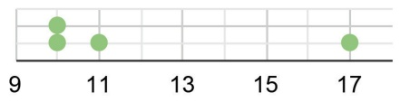
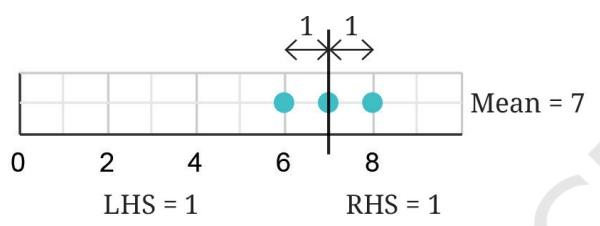
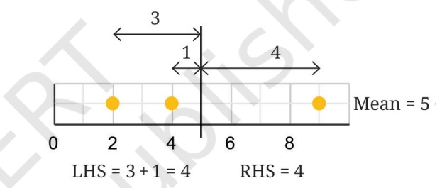
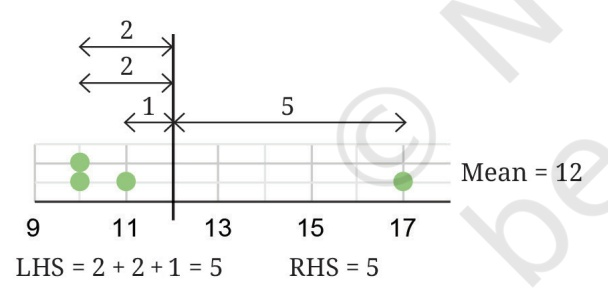
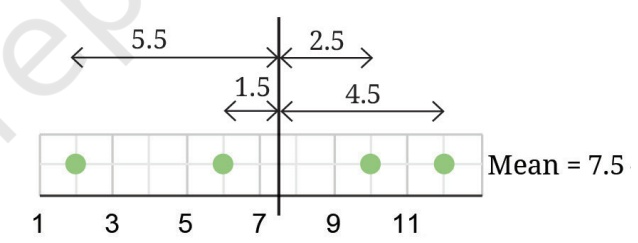

Can you explain how the mean is the centre of each collection? Mark the mean for the collections below.

<table><tr><td></td><td></td><td>●</td><td></td><td></td><td></td><td></td><td></td><td></td></tr><tr><td>0</td><td>2</td><td colspan="2">4</td><td>6</td><td colspan="2">8</td><td>10</td><td>12</td></tr></table>

Can you explain how the mean is the centre of each collection?

Is the mean the midpoint of the two endpoints/extremes of the data? It is not always so. Instead, the total distances are equal on both the sides of the mean. This is illustrated through the following dot plots.

LHS = 5.5 + 1.5 = 7 RHS = 2.5 + 4.5 = 7

Verify that this holds for all the collections of data shown earlier.

Can there be more than one such ‘centre’? In other words, is there any other value such that the sum of the distances to the values lower than it and the values higher than it will still be equal?

In the case of the collection 10, 10, 11, and 17 whose mean is 12, suppose there is a different centre larger than 12.

Clearly, all the distances on the LHS will increase and the distances on the RHS will decrease. Thus, it is no longer the ‘centre’. Similarly, for any value smaller than 12, the distances on the LHS will decrease while those on the RHS will increase.