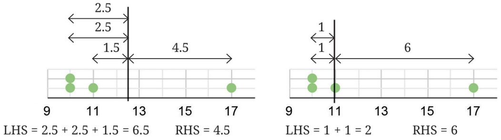
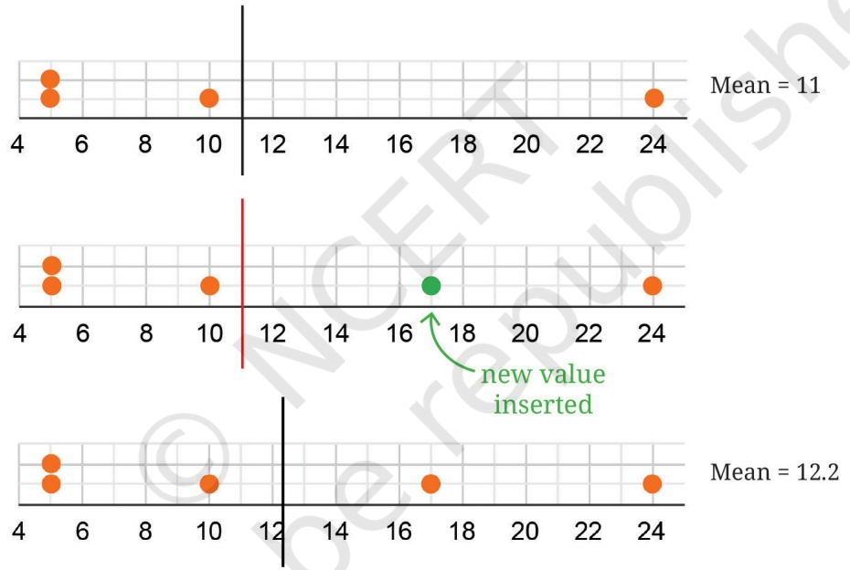

Both these cases are illustrated in the following diagram. Therefore, there is only one centre.

？ Will including a new value in the data increase or decrease the mean? When a new value greater than the mean is included, the mean LHS and RHS, as illustrated below.

Similarly, if a value smaller than the mean is included, then the new mean will be less than before.

？ What happens to the mean when an existing value is removed? When will the mean increase, decrease, or stay the same?

？ What happens to the mean if a value equal to the mean is included or removed?

Try to explain this using the fair-share interpretation of mean that we studied last year.

## Unchanging Mean!

We saw earlier how the mean varies when a value is included or removed.