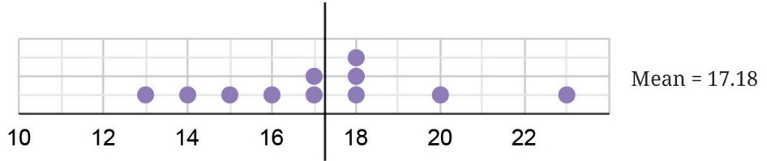
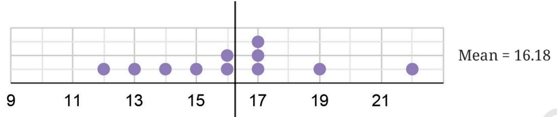
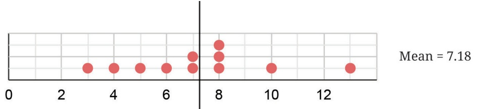

The mean of the new collection also increases by 10. Notice that the relative position of the mean stays the same.

We get the following dot plot if we reduce every value by 1.

This can be explained using algebra —

Suppose there are n values in the collection. Let these values be represented by $X _ { 1 } , X _ { 2 } , X _ { 3 } , \ldots X _ { n } .$ Their average is given by —

$$
\frac{X_{1}+X_{2}+X_{3}+\cdots+X_{n}}{n}=a.
$$

When a fixed number, for example, 3 is added to every value in the collection, the new average becomes —

$$
\frac{\overbrace{x_{1}+3)_{+}(x_{2}+3)_{+}(x_{3}+3)_{+}\cdots+(x_{n}+3)}^{n}}{n}
$$

That is, the new average is 3 more than the previous average.

Try to explain, using algebra, what the average is when a fixed number, e.g., 2 is subtracted from every value in the collection.

Try to explain this using the fair-share interpretation of average that you learnt last year.

？ What happens to the average if every value in the collection is doubled?

You may have guessed that the average also doubles. The following is an example with the data we saw earlier —

107