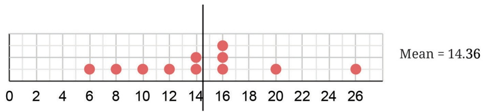
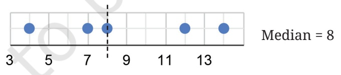
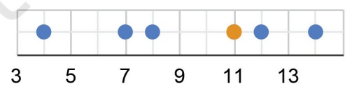
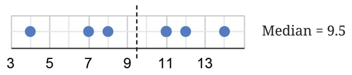

We can see that the average has doubled.

Let us prove it using algebra.

Suppose there are n values in the collection. Let these values be represented by $X_{1},X_{2},X_{3},\ldots X_{n}.$ Their average is —

$$
\frac{X_{1}^{'} + X_{2}^{'} + X_{3}^{'} + \cdots + X_{n}^{'}}{n} = a.
$$

When a fixed number, for example, 5 is multiplied to every value in the collection, the new average becomes —

$$
\begin{aligned}\underbrace{\frac{(5x_{1})_{+}(5x_{2})_{+}(5x_{3})_{+}\cdots+(5x_{n})}{n}}_{} \\= \frac{\begin{array}{c}(x_{1} + x_{2} + x_{3} + \cdots + x_{n}) \times 5 \\n \\\end{array}( using the distribution property )}{\underbrace{\begin{array}{c}(x_{1} + x_{2} + x_{3} + \cdots + x_{n}) \\n \\\end{array}}_{ 产  5a.}} \times 5.\end{aligned}
$$

That is, the new average is 5 times more than the previous average.

## Tinkering with Median

We know that the median is the middle value in the sorted data — there are an equal number of values less than it and greater than it.

？ Will including a new value to the data increase or decrease the median? Let us consider the following data. The median of this data is 8.

