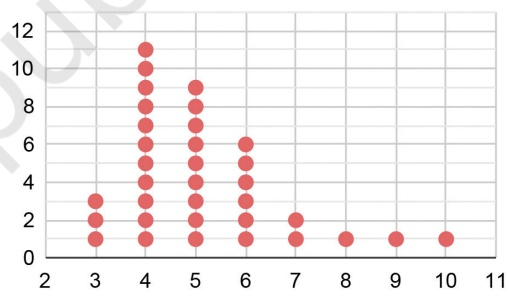

## Mean and Median with Frequencies

? What is the average family size of students in your class? How would you find this out?

We can collect the data of how many family members each student has, add them up, and divide it by the number of students. The family size data of students in a class is shown in the table here.

What is the average family size of this class?

Some of you may have thought, “Easy! It will be $\frac{3+4+5+6+7+8+9+10}{8}=\frac{52}{8}=6.5$

Remember that finding the average involves adding all the values in the data. The number 3 occurs three times, the number 4 occurs eleven times, and so on. Do these reflect in your calculation?

| Number | Frequency |
| --- | --- |
| 3 | 3 |
| 4 | 11 |
| 5 | 9 |
| 6 | 7 |
| 7 | 3 |
| 8 | 1 |
| 9 | 1 |
| 10 | 1 |

We know that the average <u>Sum of all the values in the data</u>Number of value in the data .

Accounting for the frequencies of each value, the average will be

$$
\frac{(3 \times 3) \div (4 \times 11) \div (5 \times 9) \div (6 \times 7) \div (7 \times 3) \div (8 \times 1) \div (9 \times 1) \div (10 \times 1)}{3 \div 11 + 9 \div 7 \div 3 \div 1 \div 1 \div 1}
$$

$$
\begin{aligned}=&\frac{9 + 44 + 45 + 42 + 21 + 8 + 9 + 10}{36} \\=&\frac{188}{36} = 5.22.\end{aligned}
$$

The average family size of this class is 5.22.

？ What is the median family size of this class?

We know that there are 36 values in the data. The median would be the average of the 18th and 19th value in the sequence when the data is ordered.

？ Do we need to write all the 36 numbers in order? Is there a quicker way to find out?

We can make use of the table where the frequencies are listed. We successively add the frequencies starting from the smallest value until we reach 18 and 19.

| Number | 3 | 4 | 5 | 6 | 7 | 8 | 9 | 10 |
| --- | --- | --- | --- | --- | --- | --- | --- | --- |
| Frequency | 3 | 11 | 9 | 7 | 3 | 1 | 1 | 1 |

Adding the frequencies of 3 and 4, we get $3 + 11 = 14.$ This means the value in the 14th position when the data is sorted is 4. Adding the frequencies of 3, 4, and 5, we get $3+11+9=23$ . This means the value in the 23rd position when the data is sorted is 5. We can see that all the values from positions 15 to 23 are 5. Therefore, the median of this data is 5.