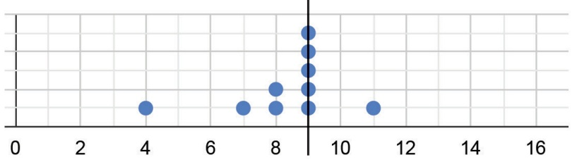

H3 fx =SUM(B3:G3)

|  | A | B | C | D | E | F | G | H |
| --- | --- | --- | --- | --- | --- | --- | --- | --- |
| 1 | Name | Odia(R1) | Telugu(R2) | English(R3) | Maths | Social | Science | Total |
| 2 | Ratna | 25 | 39 | 29 | 36 | 34 | 37 | 250× |
| 3 | Nagesh | 41 | 43 | 48 | 39 | 40 | 39 | =SUM(B3:G3) |
| 4 | Ashwin | 29 | 31 | 33 | 34 | 30 | 28 |  |
| 5 | Farooq | 47 | 46 | 38 | 42 | 49 | 44 |  |
| 6 | Mrinal | 33 | 35 | 28 | 32 | 30 | 36 |  |
| 7 | Gowri | 27 | 29 | 34 | 31 | 32 | 30 |  |
| 8 | Pankaj | 16 | 19 | 22 | 17 | 18 | 20 |  |

？ What formula would you type to find out the class average marks in Science?

Find out if the class average marks in Odia is greater than the class average marks in Telugu.

？ Show the average marks in other subjects after the last row by typing the appropriate formulae.

Try these out on a computer. You can download the tabular data from this QR code.

Get the total scores of each student by typing the appropriate formulae.

**Note to the Teacher:** You can use any spreadsheet software application such as Microsoft Excel, Google Sheets, LibreOffice Calc, etc. If there are not sufficient computers for each student, students can share a computer in groups. If that’s not possible, the computer screen can be projected for the whole class if there is only one computer available.

## Figure it Out

1. Find the mean of the following data and share your observations:

(i) The first 50 natural numbers.

(ii) The first 50 odd numbers.

(iii) The first 50 multiples of 4.

2. The dot plot below shows a collection of data and its average; but one dot is missing. Mark the missing value so that the mean is 9 (as shown below).

