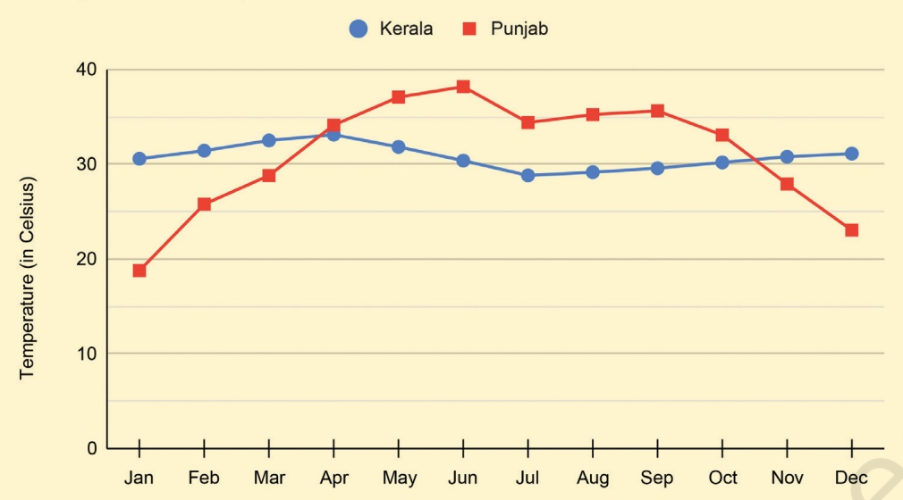

Monthly Maximum Temperature

We call such a graph made up of lines a **line graph**. Line graphs are generally used to visualise data across time.

How do we get the maximum temperature over a month in a state?

There could be a few weather stations across the state that regularly track the local temperature. We can get the monthly maximum temperature by looking at the maximum value among all the values recorded across the state.

When we try to understand how the data is collected or produced, we gain a clearer idea of its scope and can interpret it more meaningfully. It also helps us identify any limitations, such as bias or missing information, and decide how confidently we can draw conclusions from the data.

To identify and interpret the information presented, let us follow a two-step process.

## Step 1: Identify what is given

## ？ Notice how the graph is organised, what scale is used, and what patterns the data shows.

The data for each month for a city is marked and connected by lines to show the change over time. Kerala’s data is shown using blue circle marks connected by blue lines and Punjab’s data is shown in red.

The different shape markers help in easily distinguishing if the graph is printed in greyscale/black-and-white, or for people who find it difficult to distinguish colour.