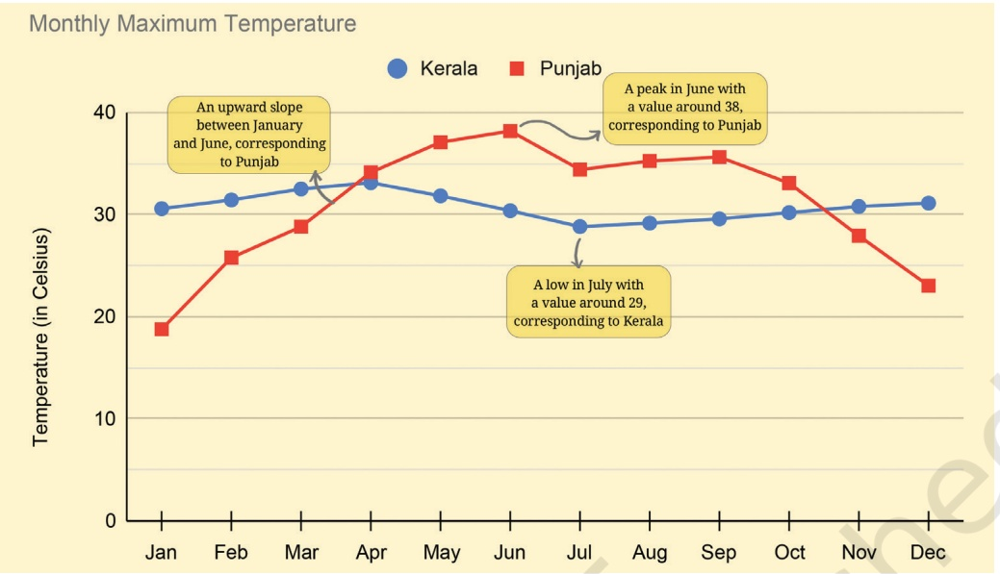
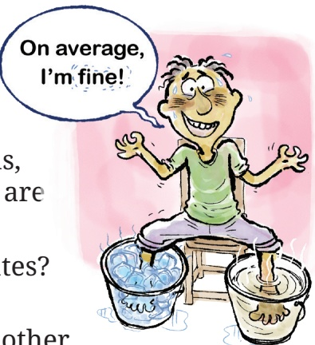

• The horizontal line shows the months of the year. The vertical line shows the temperature in ${ } ^ { \circ } \mathbb { C } .$

Step 2: Infer and interpret from what is given

？ Analyse and interpret each of the observations you made. Share appropriate summary/conclusion statements.

In Punjab, the monthly maximum temperature increases from January to June, reaching a high of $3 8 ^ { \circ } \mathbb { C } ;$ Then, it reduces to just under $3 5 ^ { \circ } \mathrm { C }$ in July, stays mostly flat till September, and then falls continuously till December, reaching about $2 3 ^ { \circ } \mathsf { C } .$ January has the lowest among the monthly maximum temperature of about $1 9 ^ { \circ } \mathsf { C } .$

Kerala’s trend is different — it stays mostly flat throughout the year. The peak is around $3 3 ^ { \circ } \mathrm { C }$ in April and the lowest point is around $2 9 ^ { \circ } \mathbb { C }$ in July. Notice that the monthly maximum temperatures in

Kerala are similar both in summer and winter!

In short, the temperature in Punjab varies more, reaching colder and warmer temperatures than in Kerala.

This can trigger questions in different directions, some of which can be answered using data. Here are some directions to think about —

Why are the trends so distinct in these two states? What factors determine a region’s temperature?

You might be curious to look at the trends of a few other states. Are there other types of trends that states exhibit?

• Which states show trends similar to Punjab’s? Is there anything common between these states?